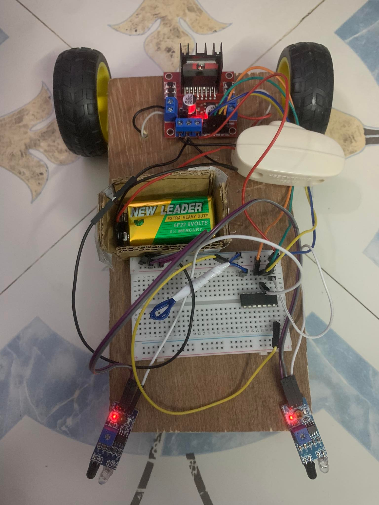
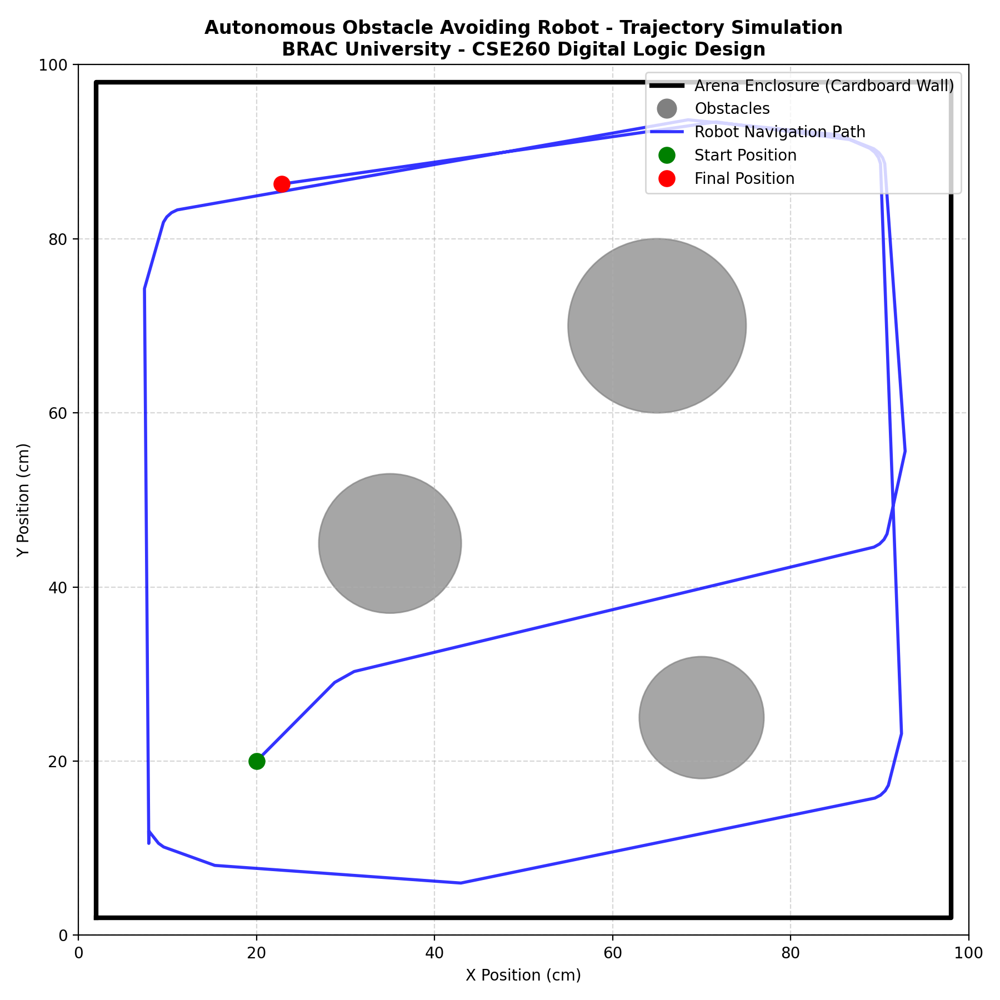
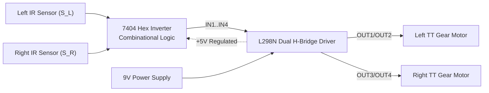
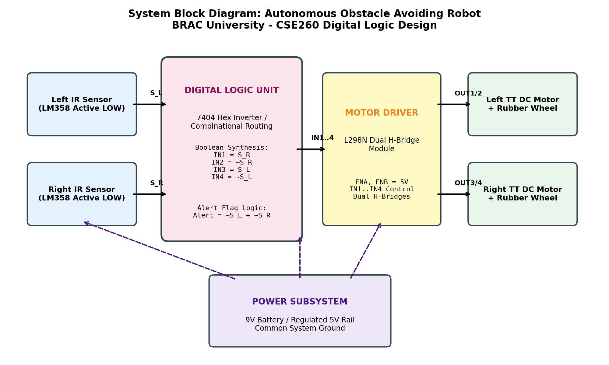
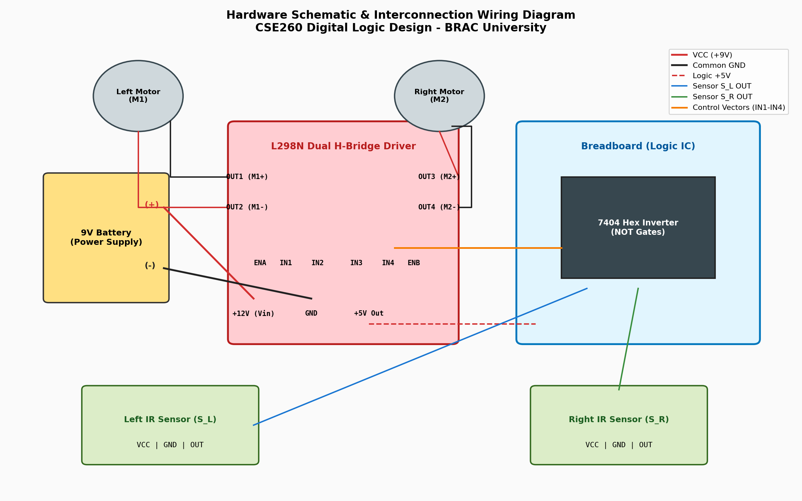

# Autonomous Obstacle Avoiding Robot (CSE260 Project)
### Digital Logic Design & Hardware Interfacing | BRAC University (2023)

[](https://www.bracu.ac.bd)
[](https://www.bracu.ac.bd)
[](#)
[](#)

An autonomous mobile robotic platform designed and built for **CSE260: Digital Logic Design** (Department of Computer Science and Engineering, BRAC University). The robot navigates collision-free inside enclosed arenas by synthesizing sensory feedback from dual forward-mounted Infrared (IR) proximity sensors through **pure combinational hardware logic** (7404 Hex Inverter) and driving two DC gear motors via an **L298N Dual H-Bridge Driver**.

---

## 📸 Project Showcase

| Physical Hardware Implementation | Navigation Trajectory Simulation |
| :---: | :---: |
|  |  |

---

## 🚀 Key Features

- **Microcontroller-Free Autonomous Operation:** Executes real-time obstacle avoidance with zero software execution overhead or clock cycle latencies.
- **Differential Steering Kinematics:** Two independently driven TT gear motors execute forward translation, pivot turns, and reverse evasive maneuvers.
- **Gate-Level Logic Synthesis:** Implements formal Boolean algebra ($IN_1 = S_R, IN_2 = \overline{S_R}, IN_3 = S_L, IN_4 = \overline{S_L}$) using standard 74-series TTL logic ICs.
- **Dual IR Optical Sensors:** Adjustable obstacle detection thresholds (2 cm – 15 cm) via onboard LM358 comparator potentiometers.
- **Ultra Low Cost:** Complete system built under **1020 BDT (~$9.50 USD)**.
- **Multi-Platform Support:** Includes complete hardware schematics, Python trajectory simulation, Verilog HDL models, and an optional Arduino Uno firmware.

---

## 📁 Repository Structure

```text
├── README.md                           # Project overview & documentation
├── .gitignore                          # Git ignore configuration
├── LICENSE                             # MIT Open-Source License
├── docs/
│   ├── LAB_PROJECT_REPORT.md           # Full BRAC University CSE Lab Report (Markdown)
│   ├── LAB_PROJECT_REPORT.pdf          # Full BRAC University CSE Lab Report (PDF)
│   ├── WIRING_AND_CIRCUIT_GUIDE.md     # Pin-to-pin wiring manual & truth tables (Markdown)
│   ├── WIRING_AND_CIRCUIT_GUIDE.pdf    # Pin-to-pin wiring manual & truth tables (PDF)
│   └── brac_logo.png                   # Official BRAC University crest
├── media/
│   ├── hardware_prototype.jpg          # High-resolution photo of assembled robot
│   ├── demo_video.mp4                  # Demonstration video of robot navigating arena
│   └── reference_context_link.txt      # Reference tutorial context link
├── schematics/
│   ├── circuit_schematic.png           # Hardware schematic & connection diagram
│   ├── system_block_diagram.png        # Architecture block diagram
│   ├── simulation_trajectory.png       # 2D arena trajectory plot
│   ├── generate_diagrams.py            # Diagram rendering script
│   └── generate_schematic.py           # Circuit schematic rendering script
└── src/
    ├── arduino/
    │   └── Obstacle_Avoiding_Robot.ino # Optional Arduino C++ firmware
    ├── verilog/
    │   ├── obstacle_avoidance_logic.v  # Verilog combinational logic module (CSE260)
    │   └── tb_obstacle_avoidance.v     # Verilog simulation testbench
    └── python/
        └── simulation.py               # 2D Kinematics and obstacle avoidance simulation
```

---

## ⚙️ System Architecture & Block Diagram





---

## 📊 Combinational Logic Truth Table

Standard IR sensors output **HIGH (1)** when clear, and switch to **LOW (0)** upon detecting an obstacle reflection.

| $S_L$ (Left IR) | $S_R$ (Right IR) | IN1 (M1+) | IN2 (M1-) | IN3 (M2+) | IN4 (M2-) | Maneuver | Description |
| :---: | :---: | :---: | :---: | :---: | :---: | :---: | :--- |
| **1** | **1** | 1 | 0 | 1 | 0 | **FORWARD** | Path unobstructed; both wheels drive forward |
| **0** | **1** | 1 | 0 | 0 | 1 | **PIVOT RIGHT** | Left obstacle detected; clockwise pivot |
| **1** | **0** | 0 | 1 | 1 | 0 | **PIVOT LEFT** | Right obstacle detected; counter-clockwise pivot |
| **0** | **0** | 0 | 1 | 0 | 1 | **REVERSE** | Head-on collision / corner; reverse retreat |

---

## 🔌 Hardware Wiring Summary



| From (Component & Pin) | To (Component & Pin) | Signal Function |
| :--- | :--- | :--- |
| **9V Battery (+)** | L298N `12V` Terminal | Inductive Motor Power (+9V) |
| **9V Battery (-)** | L298N `GND` Terminal | Common System Ground |
| **L298N `+5V Out`** | Breadboard `(+)` Bus | Regulated +5V Logic Rail |
| **L298N `GND`** | Breadboard `(-)` Bus | Common Ground Bus |
| **Left IR Sensor OUT** | L298N `IN3` & 7404 `Pin 3` | Left Sensor Signal ($S_L$) |
| **7404 `Pin 4` ($\overline{S_L}$)** | L298N `IN4` | Inverted Left Signal |
| **Right IR Sensor OUT** | L298N `IN1` & 7404 `Pin 1` | Right Sensor Signal ($S_R$) |
| **7404 `Pin 2` ($\overline{S_R}$)** | L298N `IN2` | Inverted Right Signal |
| **L298N `OUT1 & OUT2`** | Left TT DC Motor | Left Drive Wheel |
| **L298N `OUT3 & OUT4`** | Right TT DC Motor | Right Drive Wheel |

*See [WIRING_AND_CIRCUIT_GUIDE.md](docs/WIRING_AND_CIRCUIT_GUIDE.md) for full instructions.*

---

## 🛠️ Bill of Materials (BOM)

| Component | Qty | Unit Price (BDT) | Total (BDT) |
| :--- | :---: | :---: | :---: |
| L298N Dual H-Bridge Motor Driver Module | 1 | 220 TK | 220 TK |
| TT DC Gear Motors with Rubber Wheels | 2 | 120 TK | 240 TK |
| Infrared (IR) Proximity Sensor Modules | 2 | 60 TK | 120 TK |
| 7404 Hex Inverter IC (DIP-14) | 1 | 35 TK | 35 TK |
| Mini Solderless Breadboard (400 Points) | 1 | 90 TK | 90 TK |
| 9V Battery & Snap Connector | 1 | 70 TK | 70 TK |
| Chassis Base & Hardware Spacers | 1 | 150 TK | 150 TK |
| SPST Power Switch Box & Jumper Wires | 1 set | 95 TK | 95 TK |
| **Total System Cost** | | | **1020 TK** |

---

## 💻 Simulation & Software Quickstart

### 1. Python 2D Kinematics Simulation
Run the included navigation simulator:
```bash
python src/python/simulation.py
```
This generates `schematics/simulation_trajectory.png` showing the robot's collision-free path inside an arena with obstacles.

### 2. Verilog Logic Synthesis (Icarus Verilog)
To verify the combinational digital logic design:
```bash
iverilog -o sim.vvp src/verilog/obstacle_avoidance_logic.v src/verilog/tb_obstacle_avoidance.v
vvp sim.vvp
```

### 3. Arduino Uno Mode (Optional)
If using an Arduino Uno instead of pure logic gates:
1. Open `src/arduino/Obstacle_Avoiding_Robot.ino` in Arduino IDE.
2. Connect Arduino Uno via USB, select Board & Port.
3. Remove jumpers on `ENA` and `ENB`, wire them to digital pins 5 and 6 (PWM).
4. Upload sketch and monitor via Serial Monitor at 9600 baud.

---

## 📄 Academic Project Report

The complete academic lab report adhering to BRAC University CSE Department standards is available at:
👉 **[LAB_PROJECT_REPORT.md](docs/LAB_PROJECT_REPORT.md)**

---

## 👥 Contributors & Credits
- **Md. Ahnaf Iqbal**
- **Abir Hasan**
- **Hironmoy Sikder**
- **Muhammad Ashfaq Tahmeed**
- **Department of Computer Science and Engineering, BRAC University** (2023)
